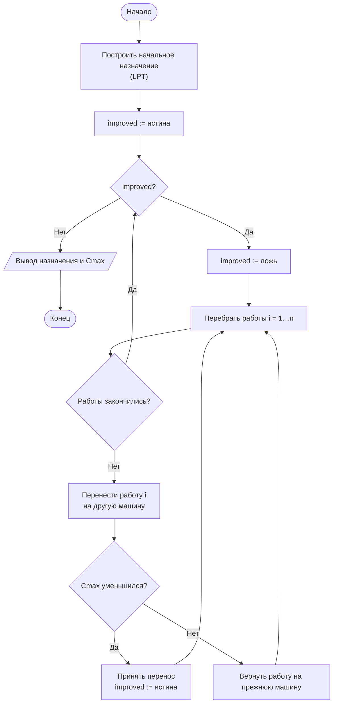
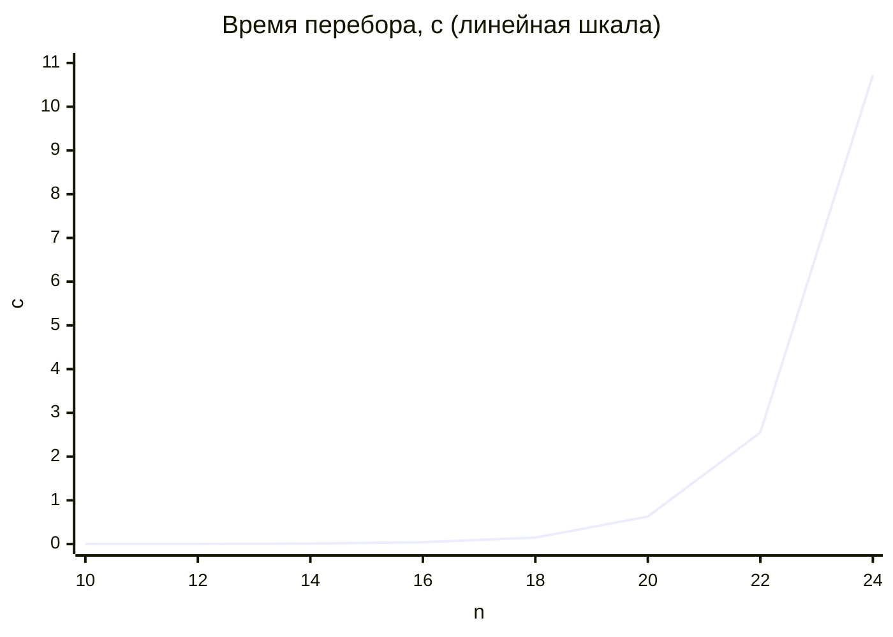

<div align="center">

**МИНИСТЕРСТВО НАУКИ И ВЫСШЕГО ОБРАЗОВАНИЯ РОССИЙСКОЙ ФЕДЕРАЦИИ**

*(полное наименование образовательной организации)*

Кафедра ____________________

# ОТЧЁТ
## по лабораторной работе № 12
### «Точные и эвристические алгоритмы решения труднорешаемых задач комбинаторной оптимизации»

**Дисциплина:** Теория алгоритмов
**Направление подготовки:** 38.03.05 «Бизнес-информатика»
**Вариант:** 7

&nbsp;

Выполнила: студентка группы БИ 2-3 Иванюшкина Дарья Андреевна

Проверил: ______________________ (ФИО преподавателя)

&nbsp;

Москва, 2026

</div>

---

## 1. Цель работы и задание варианта

**Цель работы:** изучить класс задач, для которых точные алгоритмы практически неприменимы, и освоить построение приближённых решений — конструктивной эвристики и локального поиска.

**Задание варианта 7:**

| Параметр | Значение |
|---|---|
| Задача | Составление расписания на 2 машинах |
| Точный метод | Полный перебор |
| Конструктивная эвристика | Наибольшая длительность первой (LPT) |
| Локальный поиск | Перенос работы |
| Размерности | 10…18 (точное решение), 300 (эвристики) |
| Дополнительное задание | М7 — прикладная постановка и оценка экономического эффекта |

---

## 2. Постановка задачи и обоснование NP-трудности

**Постановка.** Дано $n$ независимых работ с длительностями $t_1, \ldots, t_n$ и две одинаковые машины. Каждую работу нужно назначить ровно на одну машину. Требуется минимизировать время завершения всех работ (makespan):

$$C_{\max} = \max(L_1, L_2), \qquad L_k = \sum_{i \in M_k} t_i.$$

**NP-трудность.** Задача содержит в себе задачу о разбиении (PARTITION): можно ли разбить множество чисел на два подмножества с равными суммами? Ответ «да» тогда и только тогда, когда оптимальное $C_{\max} = \frac{1}{2}\sum t_i$. PARTITION — NP-полная задача (входит в список Карпа), поэтому оптимизационная задача на двух машинах NP-трудна. Число различных назначений равно $2^n$ (с учётом симметрии машин — $2^{n-1}$), поэтому полный перебор имеет сложность $\Theta(2^n \cdot n)$. Оговорка: задача NP-трудна «в слабом смысле» — существует псевдополиномиальный алгоритм динамического программирования по сумме длительностей, однако при большой сумме и произвольных данных он непрактичен, а для общего числа машин задача NP-трудна в сильном смысле.

**Нижняя оценка оптимума:** $C_{\max}^{*} \ge \max\left(\lceil \tfrac12 \sum t_i \rceil,\ \max t_i\right)$ — используется на большой размерности, где точное решение недоступно.

---

## 3. Описание алгоритмов

**Точный алгоритм — полный перебор.** Работа 0 фиксируется на первой машине (симметрия), для остальных $n - 1$ работ перебираются все $2^{n-1}$ наборов назначений (битовые маски); для каждого считается $C_{\max}$, запоминается минимум. Трудоёмкость $\Theta(n \cdot 2^{n})$.

**Конструктивная эвристика — наибольшая длительность первой (LPT).** Работы сортируются по убыванию длительности; каждая следующая назначается на ту машину, у которой текущая нагрузка меньше. Трудоёмкость $\Theta(n \log n)$. Известна гарантия для $m$ машин: $C_{\max}^{LPT} \le \left(\frac{4}{3} - \frac{1}{3m}\right) C_{\max}^{*}$; для $m = 2$ это $\frac{7}{6} \approx 1{,}167$.

**Локальный поиск — перенос работы.** Окрестность решения — множество назначений, получаемых переносом одной работы на другую машину. Если перенос уменьшает $C_{\max}$, он принимается; проходы повторяются, пока улучшения возможны. Трудоёмкость одного прохода $\Theta(n)$ вычислений $C_{\max}$ (в реализации — $\Theta(n^2)$ из-за пересчёта суммы). Результат — локальный оптимум.

---

## 4. Блок-схема локального поиска



---

## 5. Листинг программы

Файл `lab12_variant7.py` (Python 3.10+; для графика нужен `matplotlib`, без него программа выведет подсказку).

```python
"""ЛР № 12, вариант 7: расписание на 2 машинах (минимизация времени завершения Cmax).
Точный метод — полный перебор; эвристика — наибольшая длительность первой (LPT); локальный поиск — перенос работы; М7."""
import math
import os
import random
import statistics
import time

DIR = os.path.dirname(os.path.abspath(__file__))


def makespan(t, assign):                         # Cmax = нагрузка самой загруженной из двух машин
    s1 = sum(x for x, a in zip(t, assign) if a)
    return max(s1, sum(t) - s1)


def brute_force(t):                              # полный перебор 2^(n−1) назначений (работа 0 — на машине 0)
    n, total, best = len(t), sum(t), float("inf")
    for mask in range(1 << (n - 1)):
        s1 = sum(t[i + 1] for i in range(n - 1) if mask >> i & 1)
        best = min(best, max(s1, total - s1))
    return best


def list_schedule(t, order):                     # каждая следующая работа — на менее загруженную машину
    load, assign = [0, 0], [0] * len(t)
    for i in order:
        m = 0 if load[0] <= load[1] else 1
        assign[i], load[m] = m, load[m] + t[i]
    return assign


def lpt(t):                                      # наибольшая длительность первой
    return list_schedule(t, sorted(range(len(t)), key=lambda i: -t[i]))


def move_search(t, assign):                      # локальный поиск: переносим работу, пока Cmax уменьшается
    assign, improved = assign[:], True
    while improved:
        improved = False
        for i in range(len(t)):
            old = makespan(t, assign)
            assign[i] ^= 1
            if makespan(t, assign) < old:
                improved = True
            else:
                assign[i] ^= 1
    return assign


def main():
    print(f"{'n':>3}{'вариантов':>11}{'перебор, с':>12}")      # 1. рост времени полного перебора
    rows, n = [], 10
    while True:
        t = [random.Random(n).randint(1, 100) for _ in range(n)]
        t0 = time.perf_counter(); brute_force(t); dt = time.perf_counter() - t0
        rows.append((n, dt))
        print(f"{n:>3}{2 ** (n - 1):>11}{dt:>12.4f}")
        if dt > 10:
            break
        n += 1
    ok = [r[0] for r in rows if r[1] <= 10]
    print("Предельное n при ограничении 10 с:", max(ok))

    print(f"\n{'n':>3}{'LPT, %':>9}{'LPT+перенос, %':>16}{'случ.+перенос, %':>18}{'оптимум достигнут (LPT+пер.)':>31}")
    for n in (10, 12, 14, 16, 18):               # 2. качество на 30 наборах данных
        d1, d2, d3, hits = [], [], [], 0
        for s in range(30):
            rng = random.Random(1000 * n + s)
            t = [rng.randint(1, 100) for _ in range(n)]
            opt = brute_force(t)
            a = lpt(t)
            c1 = makespan(t, a)
            c2 = makespan(t, move_search(t, a))
            c3 = makespan(t, move_search(t, [rng.randint(0, 1) for _ in t]))
            d1.append((c1 - opt) / opt * 100); d2.append((c2 - opt) / opt * 100); d3.append((c3 - opt) / opt * 100)
            hits += c2 == opt
        print(f"{n:>3}{statistics.mean(d1):>9.2f}{statistics.mean(d2):>16.2f}{statistics.mean(d3):>18.2f}{hits / 30 * 100:>30.0f}%")

    N = 300                                      # 3. большая размерность
    rng = random.Random(7)
    t = [rng.randint(1, 100) for _ in range(N)]
    lb = max(math.ceil(sum(t) / 2), max(t))      # нижняя оценка оптимума
    rnd = [rng.randint(0, 1) for _ in t]
    print(f"\nN = {N}, сумма длительностей {sum(t)}, нижняя оценка оптимума {lb}")
    res = {}
    for name, f in (("Случайное назначение", lambda: rnd), ("По порядку (без сортировки)", lambda: list_schedule(t, range(N))),
                    ("LPT", lambda: lpt(t)), ("LPT + перенос", lambda: move_search(t, lpt(t))),
                    ("Случайное + перенос", lambda: move_search(t, rnd))):
        t0 = time.perf_counter(); a = f(); dt = time.perf_counter() - t0
        res[name] = makespan(t, a)
        print(f"  {name:<28} Cmax {res[name]:>5}  ({(res[name] - lb) / lb * 100:5.2f} % над нижней оценкой), время {dt:.4f} с")

    # М7: прикладная постановка — распределение заказов между двумя станками (длительности в часах), 250 смен в год
    cost, days = 1500, 250                       # условная стоимость машино-часа, руб.; рабочих дней в году
    for base in ("Случайное назначение", "По порядку (без сортировки)"):
        gain = res[base] - res["LPT + перенос"]
        print(f"М7: замена «{base}» на LPT + перенос: выигрыш {gain} ч за цикл, за год {gain * days} ч ≈ "
              f"{format(gain * days * cost, ',').replace(',', ' ')} руб.")

    try:
        import matplotlib.pyplot as plt
        plt.semilogy([r[0] for r in rows], [r[1] for r in rows], "o-")
        plt.xlabel("n"); plt.ylabel("Время перебора, с"); plt.title("Полный перебор (лог. шкала)"); plt.grid(True, which="both")
        plt.savefig(os.path.join(DIR, "brute_time.png"), dpi=150)
        print("График сохранён в:", DIR)
        plt.show()
    except ImportError:
        print("Установите matplotlib: pip install matplotlib")


if __name__ == "__main__":
    main()
```

---

## 6. Рост времени точного метода

Измерения выполнены в среде Linux, Python 3.13. Длительности — случайные целые от 1 до 100.

**Таблица 1. Время полного перебора**

| $n$ | Вариантов $2^{n-1}$ | Время, с |
|---|---|---|
| 10 | 512 | 0,0005 |
| 11 | 1 024 | 0,0012 |
| 12 | 2 048 | 0,0024 |
| 13 | 4 096 | 0,0050 |
| 14 | 8 192 | 0,0111 |
| 15 | 16 384 | 0,0243 |
| 16 | 32 768 | 0,0426 |
| 17 | 65 536 | 0,0680 |
| 18 | 131 072 | 0,1470 |
| 19 | 262 144 | 0,3132 |
| 20 | 524 288 | 0,6303 |
| 21 | 1 048 576 | 1,4081 |
| 22 | 2 097 152 | 2,5457 |
| 23 | 4 194 304 | 5,3753 |
| 24 | 8 388 608 | 10,7190 |

Каждое увеличение $n$ на единицу увеличивает время примерно вдвое. **Предельная размерность при ограничении 10 с: $n = 23$** (при $n = 24$ время превысило 10 с). Экстраполяция: $n = 40$ — около 8 суток ($5{,}4 \cdot 2^{17}$ с), $n = 50$ — около 23 лет, $n = 300$ — недостижимо.

**График в логарифмической шкале** (файл `brute_time.png`, создаётся программой; прямая линия в лог-шкале означает показательный рост):




---

## 7. Отклонение эвристик от оптимума на малых размерностях

Для каждого $n$ использовано 30 случайных наборов данных; отклонение $= (C_{\max} - C_{\max}^{*}) / C_{\max}^{*} \cdot 100\,\%$, где оптимум получен полным перебором. Для сравнения добавлен локальный поиск из случайного начального назначения.

**Таблица 2. Среднее отклонение от оптимума (30 наборов)**

| $n$ | LPT, % | LPT + перенос, % | Случайное + перенос, % | Оптимум достигнут (LPT + перенос) |
|---|---|---|---|---|
| 10 | 1,59 | 1,59 | 1,23 | 10 % |
| 12 | 0,98 | 0,98 | 1,89 | 23 % |
| 14 | 0,63 | 0,63 | 0,96 | 30 % |
| 16 | 0,38 | 0,38 | 0,95 | 27 % |
| 18 | 0,34 | 0,34 | 0,79 | 27 % |

**Наблюдения.**

- Отклонение LPT мало (менее 1,6 %) и убывает с ростом $n$ — намного лучше теоретической гарантии 16,7 %.
- **Перенос работы не улучшает решение LPT:** оно уже является локальным оптимумом по этой окрестности (перенос одной работы с более загруженной машины на менее загруженную не помогает, так как LPT выравнивает нагрузки с точностью до одной работы). Поэтому столбцы «LPT» и «LPT + перенос» совпадают. Это нормальный результат, а не ошибка: локальный поиск ценен там, где начальное решение плохое.
- Из случайного начального назначения перенос даёт отклонение 0,8–1,9 %: локальный поиск сильно улучшает плохое начальное решение, но в среднем не лучше качественной конструктивной эвристики.
- Точный оптимум достигается лишь в 10–30 % наборов: при малых $n$ с произвольными длительностями идеальное разбиение редко, а остаток 1–2 единицы даёт заметный относительный процент.

---

## 8. Результаты на большой размерности ($N = 300$)

Длительности — случайные целые от 1 до 100; сумма 14 747; нижняя оценка оптимума 7 374.

**Таблица 3. Сравнение методов при $N = 300$**

| Метод | $C_{\max}$ | Над нижней оценкой, % | Время, с |
|---|---|---|---|
| Случайное назначение | 8 225 | 11,54 | < 0,0001 |
| По порядку (без сортировки) | 7 379 | 0,07 | < 0,0001 |
| LPT | 7 374 | 0,00 | 0,0001 |
| LPT + перенос | 7 374 | 0,00 | 0,0068 |
| Случайное + перенос | 7 374 | 0,00 | 0,0133 |

LPT достиг нижней оценки, то есть **доказуемо оптимален** для этого набора (оптимум не может быть меньше 7 374). При $N = 300$ полный перебор потребовал бы около $2^{299} \approx 10^{90}$ вариантов. Результаты зависят от случайного набора и на другой машине будут иными.

---

## 9. Дополнительное задание М7: прикладная постановка и экономический эффект

**Постановка.** Производственный участок с двумя одинаковыми станками получает 300 заказов в день (длительности обработки 1–100 ч — условные единицы, как в эксперименте). Следующий рабочий день начинается после завершения последнего заказа на обоих станках, поэтому длина цикла равна $C_{\max}$. Принятые допущения: стоимость машино-часа 1 500 руб., 250 рабочих дней в году, цикл раз в день; выигрыш в $C_{\max}$ считается освобождённым временем.

**Таблица 4. Оценка эффекта перехода к LPT + перенос**

| Исходный способ распределения | $C_{\max}$ | Выигрыш за цикл, ч | За год, ч | Эффект, руб./год |
|---|---|---|---|---|
| Случайное (ручное, без учёта нагрузки) | 8 225 | 851 | 212 750 | 319 125 000 |
| По порядку поступления, на менее загруженный станок | 7 379 | 5 | 1 250 | 1 875 000 |

Вывод: основной выигрыш даёт сам отказ от случайного распределения (простое правило «на менее загруженный» уже снижает потери до 0,07 %); дальнейший переход к LPT даёт малую, но бесплатную добавку: при дорогом станко-часе даже 5 ч за цикл окупаются. Расчёт иллюстративный: цифры зависят от принятых допущений и реальной загрузки.

**Полный вывод программы:**

```
  n  вариантов  перебор, с
 10        512      0.0005
 11       1024      0.0011
 12       2048      0.0024
 13       4096      0.0052
 14       8192      0.0106
 15      16384      0.0240
 16      32768      0.0317
 17      65536      0.0600
 18     131072      0.1536
 19     262144      0.2856
 20     524288      0.6023
 21    1048576      1.1449
 22    2097152      2.7484
 23    4194304      5.1175
 24    8388608     10.8067
Предельное n при ограничении 10 с: 23

  n   LPT, %  LPT+перенос, %  случ.+перенос, %   оптимум достигнут (LPT+пер.)
 10     1.59            1.59              1.23                            10%
 12     0.98            0.98              1.89                            23%
 14     0.63            0.63              0.96                            30%
 16     0.38            0.38              0.95                            27%
 18     0.34            0.34              0.79                            27%

N = 300, сумма длительностей 14747, нижняя оценка оптимума 7374
  Случайное назначение         Cmax  8225  (11.54 % над нижней оценкой), время 0.0000 с
  По порядку (без сортировки)  Cmax  7379  ( 0.07 % над нижней оценкой), время 0.0000 с
  LPT                          Cmax  7374  ( 0.00 % над нижней оценкой), время 0.0001 с
  LPT + перенос                Cmax  7374  ( 0.00 % над нижней оценкой), время 0.0068 с
  Случайное + перенос          Cmax  7374  ( 0.00 % над нижней оценкой), время 0.0133 с
М7: замена «Случайное назначение» на LPT + перенос: выигрыш 851 ч за цикл, за год 212750 ч ≈ 319 125 000 руб.
М7: замена «По порядку (без сортировки)» на LPT + перенос: выигрыш 5 ч за цикл, за год 1250 ч ≈ 1 875 000 руб.
График сохранён в: /home/claude/lab12v7
```

---

## 10. Выводы и рекомендации

1. Время полного перебора растёт показательно: каждая дополнительная работа удваивает время; при ограничении 10 с предельный размер $n = 23$ (при $n = 24$ — 10,7 с). Для 300 работ точное решение недостижимо ($\approx 10^{90}$ вариантов), что соответствует NP-трудности задачи.
2. Эвристика LPT (наибольшая длительность первой) даёт решение за $\Theta(n \log n)$ с отклонением 0,3–1,6 % от оптимума на $n = 10…18$ (убывает с ростом $n$) — значительно лучше теоретической гарантии 7/6.
3. Локальный поиск «перенос работы» не улучшил решение LPT: оно уже является локальным оптимумом этой окрестности. Из случайного начального назначения перенос даёт 0,8–1,9 % отклонения, то есть эффективно исправляет плохие решения, но не превосходит хорошую конструктивную эвристику. Для дальнейшего улучшения нужна более широкая окрестность (обмен двух работ) или метаэвристики.
4. На $N = 300$ LPT совпал с нижней оценкой, то есть найден оптимум; время расчёта — доли миллисекунды.
5. **Рекомендация:** для $n \le 20$ можно использовать полный перебор, если нужен гарантированный оптимум; для больших $n$ — LPT, при необходимости с локальным поиском; качество следует оценивать относительно нижней оценки. Заказчику формулируется требование «решение не более чем на $x\,\%$ хуже оптимума за приемлемое время», а не «оптимум любой ценой».
6. Ограничения: данные случайны и равномерны; на специально подобранных наборах (например, три очень длинные работы и много коротких) LPT может давать большее отклонение, а оценки экономического эффекта основаны на условных допущениях.

---

## 11. Ответы на контрольные вопросы (кратко)

1. Полиномиальный алгоритм остаётся применимым при росте $n$; экспоненциальный — нет: уже при $n \approx 50$ расчёт занимает годы.
2. Ускорение техники в $k$ раз увеличивает доступное $n$ на $\log_2 k$ при $2^n$ (удвоение быстродействия — на одну работу).
3. P — задачи, решаемые за полиномиальное время; NP — те, чьё решение можно проверить за полиномиальное время. Вопрос $\text{P} = \text{NP}$ — совпадают ли эти классы; он открыт.
4. NP-полная задача — самая трудная в NP (к ней сводятся все задачи NP); NP-трудная — не легче NP-полных, но может не лежать в NP (например, оптимизационная версия).
5. Для коммивояжёра: $(n-1)!$ маршрутов, или $(n-1)!/2$ для симметричной матрицы.
6. Из текущего города — в ближайший непосещённый; последние переходы вынужденно длинные, так как пропущенные города остаются «на потом».
7. Окрестность — решения, получаемые небольшим изменением данного; локальный оптимум — решение, которое нельзя улучшить в пределах окрестности.
8. 2-opt: удалить два ребра и развернуть участок между ними; один проход — $\Theta(n^2)$.
9. Многократный запуск, расширение окрестности (3-opt), имитация отжига, генетические алгоритмы, поиск с запретами.
10. Показать, что точное решение недостижимо по времени, а эвристика даёт известное и малое отклонение от нижней оценки или оптимума, при этом стоит долей секунды.

---

## 12. Использованная литература

1. Кормен Т., Лейзерсон Ч., Ривест Р., Штайн К. Алгоритмы: построение и анализ. — 3-е изд. — М.: Вильямс, 2013. — Гл. 34, 35.
2. Гэри М., Джонсон Д. Вычислительные машины и труднорешаемые задачи. — М.: Мир, 1982.
3. Пападимитриу Х., Стайглиц К. Комбинаторная оптимизация. Алгоритмы и сложность. — М.: Мир, 1985.
4. Скиена С. Алгоритмы. Руководство по разработке. — 3-е изд. — СПб.: БХВ-Петербург, 2022. — Гл. 9, 16.
5. Рафгарден Т. Совершенный алгоритм. Алгоритмы для NP-трудных задач. — СПб.: Питер, 2021.
